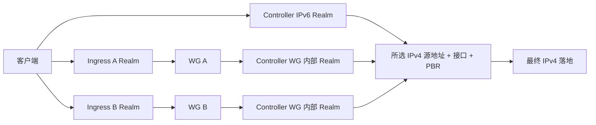

# 架构与状态

## 模块

`models.py` 校验对象；`storage.py` 保存期望配置/版本/历史；`system.py` 是唯一 subprocess 适配层，argv 执行、超时、不使用 shell、不回显潜在敏感参数。纯逻辑测试可替换 Runner、Network、Services、Transport。

`rules.py` 校验引用、协议与监听冲突；`realm.py` 编译 TOML 和独立 unit；`deployment.py` 负责持久日志和文件/服务补偿；`sync.py` 协调多个 Ingress；`wireguard.py` 单独管理密钥及隧道。更改 Realm 规则不会调用 WG 密钥或重启隧道。`wg_link.py` 通过固定 ip/wg 参数执行原生 WG，私钥只经标准输入传给 wg，不执行配置中的 Shell hook；接口创建时附带已持久化的唯一所有权标记，回收前核对标记。

## 数据模型

规则含稳定 `rule_id`、名称、备注、启停、协议、目标、出口、创建/更新时间、递增版本和删除标记。`bindings` 是规范化入口列表，每项独立保存前置机 ID、公网地址/端口、WG 目标地址及内部端口；`local` 表示 IPv6 直连。该结构表示一对多映射，避免单个 `public_listen_port` 无法表达多入口端口的歧义。可由 `Rule.ingress_type` 与 `ingress_server_ids` 读取聚合信息。

内部 WG 端口在该隧道的 Controller 地址上自动分配；不会更改指定公网端口。禁用规则仍预留端口，避免重新启用时抢占。不同 TCP-only / UDP-only 规则可用独立进程共享同一数字端口。生成 IPv6 监听均设置 `ipv6_only = true`。

出口记录区分 `managed=false` 的外部配置和自建路由。外部服务只作为依赖读取，不运行它的重建脚本。不添加 IX 静态路由。

隧道和前置机独立，前置机引用隧道。配置不含真实私钥或 SSH 密码；WG 私钥只在本机 0600 文件中。同步 SSH 私钥路径仅保存在 Controller 本机。

## 应用事务

1. 校验完整对象和引用、监听、源地址与有效路由。
2. 备份当前受管文件及 systemd active/enabled 状态。
3. 写入并 fsync 恢复日志，然后原子写候选文件。
4. 仅停止发生变化的受管单元，启动候选单元，检查进程及实际 TCP/UDP 监听。
5. SQLite 事务同时提交受管清单、应用结果和日志提交标记。
6. 删除未完成日志。失败时恢复文件、启用状态和原服务。

崩溃恢复根据提交标记区分“已提交、仅来不及清理日志”和“未提交、需要补偿”。文件锁不删除，避免等待者锁到不同 inode。SQLite `BEGIN IMMEDIATE` 与预期版本防止丢失更新。

WG/PBR 属于独立资源事务，不纳入 Realm 规则事务；它们的修改必须单独应用。它们同样保存持久资源日志，正常启动由各自 systemd 单元恢复。恢复日志与备份的覆盖范围、维护限制见运维文档。

## 分布式同步

每台 Ingress 独立递增版本；完整快照含 schema、server_id、revision、端点列表和 SHA-256。校验值检测破损，身份认证由 SSH 密钥和已核验主机指纹承担。Agent 拒绝旧版本、相同版本不同内容、越权地址/目标/接口/依赖和未知字段。

添加/更新先准备 Controller。对于删除的旧内部监听，保持到所有受影响前置机确认撤销后再删除。前置机本地应用失败会恢复前一有效配置并保留原确认版本。Controller 留存部分成功状态，重试最新完整快照，不伪造全局成功。

`ready-rules` 只包含已在本机准备的规则，生成快照不会把其他尚未应用的编辑顺便开放到公网。快照应用和确认版本的提交使用同一 SQLite 事务；重放相同版本也检查真实服务状态。定时器在没有编辑时也会核验各前置机；WG 监听地址消失时仅撤下受影响端点，保留同一规则的其他入口。

状态：`PENDING_SYNC → APPLYING → ACTIVE / DISABLED`；验证或本机失败为 `FAILED`，部分前置机成功为 `OUT_OF_SYNC`。历史版本回滚也是新期望版本，revision 不倒退。

活动规则定期复核路由。发现源地址、接口、网关或表不匹配时停止该规则的本机监听，保留文件和错误状态，等待正确路由恢复后重试。该监测有定时器周期，不替代内核防泄露策略。
