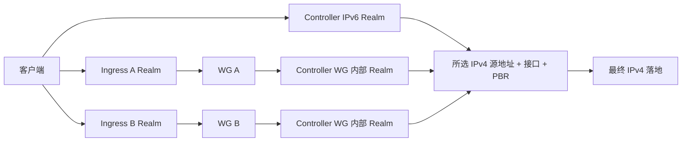

# 架构与状态

## 模块

`models.py` 校验对象；`storage.py` 保存期望配置/版本/历史；`system.py` 是唯一 subprocess 适配层，argv 执行、超时、不使用 shell、不回显潜在敏感参数。纯逻辑测试可替换 Runner、Network、Services、Transport。

`rules.py` 校验引用、协议与监听冲突；`realm.py` 编译 TOML 和独立 unit；`deployment.py` 负责持久日志和文件/服务补偿；`sync.py` 协调多个 Ingress；`wireguard.py` 单独管理密钥及隧道。`network.py` 从内核 JSON 识别默认路由、source rule、路由表和有效查找；`persistence.py` 实现 Netplan/networkd 后端、变更计划、回滚保护和所有权校验；`routing.py` 兼容 v0.1.0 数据并协调旧 oneshot 迁移。更改 Realm 规则不会调用 WG 密钥或重启隧道。`wg_link.py` 通过固定 ip/wg 参数执行原生 WG，私钥只经标准输入传给 wg，不执行配置中的 Shell hook；接口创建时附带已持久化的唯一所有权标记，回收前核对标记。

## 数据模型

规则含稳定 `rule_id`、名称、备注、启停、协议、目标、出口、创建/更新时间、递增版本和删除标记。`bindings` 是规范化入口列表，每项独立保存前置机 ID、公网地址/端口、WG 目标地址及内部端口；`local` 表示 IPv6 直连。该结构表示一对多映射，避免单个 `public_listen_port` 无法表达多入口端口的歧义。可由 `Rule.ingress_type` 与 `ingress_server_ids` 读取聚合信息。

内部 WG 端口在该隧道的 Controller 地址上自动分配；不会更改指定公网端口。禁用规则仍预留端口，避免重新启用时抢占。不同 TCP-only / UDP-only 规则可用独立进程共享同一数字端口。生成 IPv6 监听均设置 `ipv6_only = true`。

出口记录保留 v0.1.0 的 `managed` 字段，同时新增明确的 `management` 与 `backend`：

| management | 所有者 | 行为 |
|---|---|---|
| `system` | 系统 main 默认路由 | 只读复用，不改默认网关；backend 固定为 `system` |
| `external` | 管理员/其他网络配置 | 识别、显示、检查和供 Realm 使用；故障只报告 |
| `relayaxis` | RelayAxis | 仅非 main 独立表；backend 为 `auto`、`netplan`、`networkd` 或待迁移的 `legacy-oneshot` |

兼容映射固定为：旧 `managed=true` 仍属 RelayAxis；旧 `managed=false + main` 为 `system`；其他旧 `managed=false` 为 `external`。升级不会把外部路由改成自建资源。运营商名称只是 `name` 展示字段，不参与选路。

默认出口由 main 表全部 default route 的 metric 决定。唯一最低 metric 且源地址唯一时才标记 `is_default`；相同最低 metric、多路径、缺失 default 或源地址推断不唯一时，发现结果标记需要确认且不自动选中。简单 `/32` source-policy 即使源地址已经丢失也会保留在发现结果中，便于明确报告 `SOURCE_MISSING`；健康状态需要同时满足本机地址、source rule、目标表 default route 和有效查找。

隧道和前置机独立，前置机引用隧道。配置不含真实私钥或 SSH 密码；WG 私钥只在本机 0600 文件中。同步 SSH 私钥路径仅保存在 Controller 本机。

## 应用事务

1. 校验完整对象和引用、监听、源地址与有效路由。
2. 备份当前受管文件及 systemd active/enabled 状态。
3. 写入并 fsync 恢复日志，然后原子写候选文件。
4. 仅停止发生变化的受管单元，启动候选单元，检查进程及实际 TCP/UDP 监听。
5. SQLite 事务同时提交受管清单、应用结果和日志提交标记。
6. 删除未完成日志。失败时恢复文件、启用状态和原服务。

崩溃恢复根据提交标记区分“已提交、仅来不及清理日志”和“未提交、需要补偿”。文件锁不删除，避免等待者锁到不同 inode。SQLite `BEGIN IMMEDIATE` 与预期版本防止丢失更新。

WG/PBR 属于独立资源事务，不纳入 Realm 规则事务；它们的修改必须单独应用。Netplan 后端只创建 `/etc/netplan/90-relayaxis-egress-ID.yaml`，依靠 Netplan 合并保留 cloud-init、地址、IPv6、DNS、MAC match 和其他 route；接口被 `set-name` 重命名时，候选文件引用既有 Netplan 定义 ID。原生 networkd 后端先读取当前实际生效的 `.network` 文件，再在 `/etc/systemd/network/BASENAME.network.d/` 创建 drop-in，避免创建另一个会抢先匹配的 `.network`。

网络变更事务为：

1. 检查源地址、接口、表/优先级冲突、文件所有权及唯一 main 默认路由。
2. 在临时 root 合并全部 Netplan 文件并执行真实 `netplan generate`；networkd drop-in 做严格字段校验。
3. 输出 diff 和绑定网络事实的 `plan-id`，无显式确认不写系统配置。
4. 写恢复日志与快照，先创建独立的 90 秒 systemd 回滚计时器，再原子写候选，消除候选已落盘但回滚保护尚未建立的窗口。
5. Netplan 首次应用使用 `netplan apply`；networkd 使用 `networkctl reload` 与单接口 `reconfigure`。
6. 重新检查 main 默认路由、SSH 客户端选路、source rule、目标表 default 以及带 source/oif 的 `ip route get`。
7. 成功后原子提交所有权和事务标记并取消计时器；任一步失败恢复旧文件并重新加载。

周期恢复不执行全局 `netplan apply`：对已登记且内容哈希未漂移的自建资源，Netplan 只重新 generate，再用 networkctl 定向重配所属接口。承载 main 默认路由或当前 SSH 管理路径的接口不进入自动重配。外部出口永远只报告。

## 分布式同步

每台 Ingress 独立递增版本；完整快照含 schema、server_id、revision、端点列表和 SHA-256。校验值检测破损，身份认证由 SSH 密钥和已核验主机指纹承担。Agent 拒绝旧版本、相同版本不同内容、越权地址/目标/接口/依赖和未知字段。

添加/更新先准备 Controller。对于删除的旧内部监听，保持到所有受影响前置机确认撤销后再删除。前置机本地应用失败会恢复前一有效配置并保留原确认版本。Controller 留存部分成功状态，重试最新完整快照，不伪造全局成功。

`ready-rules` 只包含已在本机准备的规则，生成快照不会把其他尚未应用的编辑顺便开放到公网。快照应用和确认版本的提交使用同一 SQLite 事务；重放相同版本也检查真实服务状态。定时器在没有编辑时也会核验各前置机；WG 监听地址消失时仅撤下受影响端点，保留同一规则的其他入口。

状态：`PENDING_SYNC → APPLYING → ACTIVE / DISABLED`；验证或本机失败为 `FAILED`，部分前置机成功为 `OUT_OF_SYNC`。历史版本回滚也是新期望版本，revision 不倒退。

活动规则定期复核真实 source rule、目标表 default 和带端口的有效查找。状态区分 `HEALTHY / DEGRADED / ROUTE_MISSING / RULE_MISSING / SOURCE_MISSING / WRONG_INTERFACE / WRONG_GATEWAY / WRONG_TABLE / UNREACHABLE / UNKNOWN`。发现源地址、接口、网关或表不匹配时停止该规则的本机监听，保留文件和错误状态，等待正确路由恢复后重试。Realm 同时设置 `through` 和 `interface`，所以 PBR 丢失不会把同一业务静默发到其他物理出口。该监测有定时器周期，不替代内核防泄露策略。
